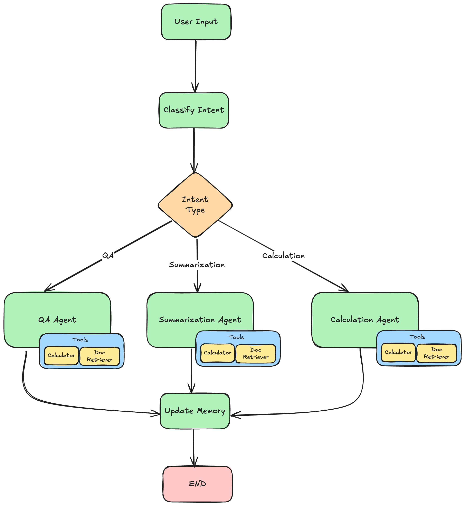
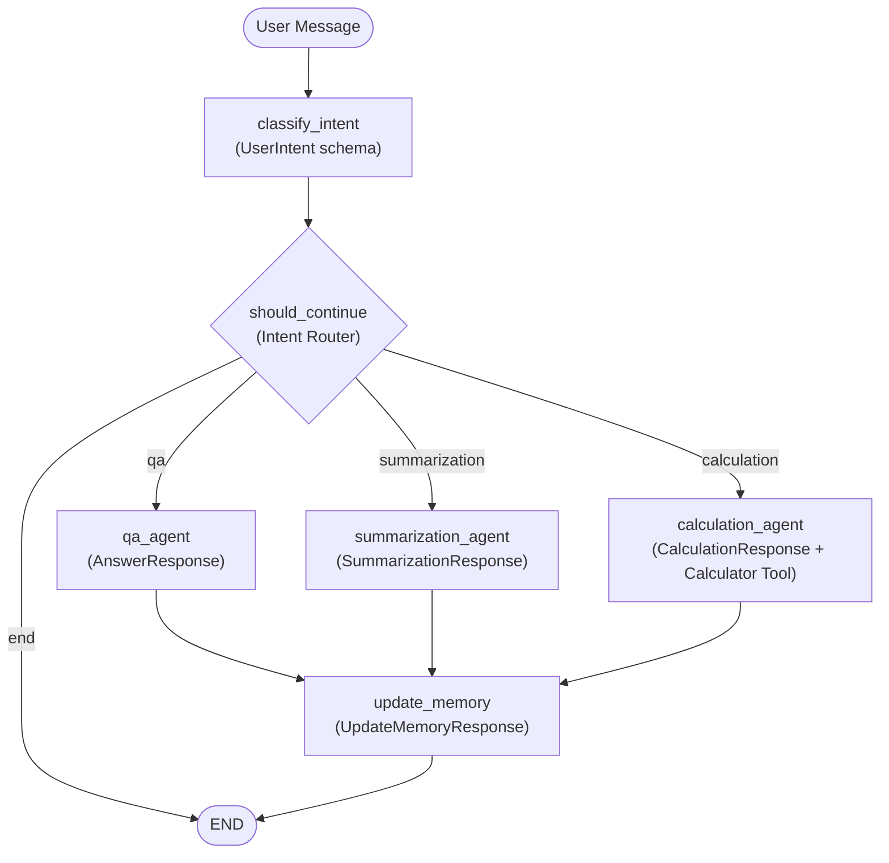

# DocDacity: Intelligent Multi-Agent Document Assistant



An enterprise-grade document processing and reasoning system built with **Python**, **LangChain**, and **LangGraph**. The assistant intelligently handles financial and healthcare documents (invoices, service agreements, medical claims) by classifying user intent and dynamically routing requests to specialized agents: **Q&A Agent**, **Summarization Agent**, and **Calculation Agent**.

The system features robust Pydantic data schemas, safe expression evaluation tools, persistent conversation memory powered by LangGraph checkpointers (`InMemorySaver`), state reducers (`operator.add`), and session storage.

---

## Table of Contents
1. [Architecture Overview](#architecture-overview)
2. [Project Structure](#project-structure)
3. [Implementation Details](#implementation-details)
   - [Task 1: Schema Implementation (`schemas.py`)](#task-1-schema-implementation)
   - [Task 2: Agent State & Workflow (`agent.py`, `assistant.py`)](#task-2-agent-state--workflow)
   - [Task 3: Prompt Engineering (`prompts.py`)](#task-3-prompt-engineering)
   - [Task 4: Tool Implementation (`tools.py`)](#task-4-tool-implementation)
4. [How State & Memory Work](#how-state--memory-work)
5. [How Structured Outputs Are Enforced](#how-structured-outputs-are-enforced)
6. [Example Conversations & Execution Evidence](#example-conversations--execution-evidence)
7. [Installation & Setup](#installation--setup)
8. [Testing & Verification](#testing--verification)

---

## Architecture Overview

The multi-agent system uses a stateful directed graph (LangGraph `StateGraph`) with conditional routing:



### Workflow Stages:
1. **Entry Point (`classify_intent`)**: Classifies the user's intent into `qa`, `summarization`, `calculation`, or `unknown` using few-shot guidance and structured output.
2. **Conditional Router (`should_continue`)**: Inspects `next_step` on `AgentState` and routes execution to the appropriate specialist agent.
3. **Specialist Agent Execution**:
   - **`qa_agent`**: Retrieves documents and extracts direct answers, citing sources with a confidence score.
   - **`summarization_agent`**: Reads document chunks, synthesizes key points, and outlines actionable terms.
   - **`calculation_agent`**: Extracts numerical fields, retrieves values from documents, constructs arithmetic expressions, and calls the safe calculator tool.
4. **Memory Synchronization (`update_memory`)**: Generates an ongoing conversation summary, tracks active document IDs, and updates persistent state.
5. **Checkpointer Persistence (`InMemorySaver`)**: Preserves graph state across multiple conversational turns using `thread_id = session_id`.

---

## Project Structure

```text
doc_assistant_project/
├── src/
│   ├── __init__.py           # Package indicator
│   ├── schemas.py            # Pydantic v2 data models & validation
│   ├── retrieval.py          # Simulated in-memory document store & search
│   ├── tools.py              # Calculator, search, reader, and statistics tools
│   ├── prompts.py            # Context-aware system and intent prompt templates
│   ├── agent.py              # LangGraph workflow, nodes, and state definition
│   └── assistant.py          # DocumentAssistant facade & session manager
├── docs/
│   └── langgraph_agent_architecture.png
├── sessions/                 # Auto-generated persistent session JSON files
├── logs/                     # Auto-generated persistent tool usage audit logs
├── tests/                    # Unit and integration test suite
│   ├── __init__.py
│   ├── test_schemas.py
│   ├── test_prompts.py
│   ├── test_tools_calculator.py
│   ├── test_retrieval.py
│   ├── test_workflow.py
│   └── test_assistant_integration.py
├── demo_runner.py            # Automated end-to-end verification script
├── main.py                   # Interactive CLI application
├── requirements.txt          # Python dependencies
├── .env.example              # Environment variables template
├── .gitignore                # Source control ignore rules
└── README.md                 # Project documentation
```

---

## Implementation Details

### Task 1: Schema Implementation (`src/schemas.py`)

All data exchange models are implemented using **Pydantic v2**:

- **`AnswerResponse`** (Task 1.1):
  - `question`: Original user question string.
  - `answer`: Generated answer text.
  - `sources`: List of referenced document IDs (`default_factory=list`).
  - `confidence`: Confidence score bounded strictly between `0.0` and `1.0` (`ge=0.0, le=1.0`).
  - `timestamp`: Response generation time (`default_factory=datetime.now`).
- **`UserIntent`** (Task 1.2):
  - `intent_type`: Constrained via `Literal["qa", "summarization", "calculation", "unknown"]`.
  - `confidence`: Bounded between `0.0` and `1.0`.
  - `reasoning`: Explanation for the classification.
- **Supporting Schemas**:
  - `DocumentChunk`: Text chunk with metadata and relevance score.
  - `SummarizationResponse`: Original text length, structured summary, key points list, and document IDs.
  - `CalculationResponse`: Evaluated expression, numerical result, explanation, units, and timestamp.
  - `UpdateMemoryResponse`: Comprehensive conversation summary and updated active document IDs.
  - `SessionState`: Persistent session metadata tracking history, document context, and timestamps.

### Task 2: Agent State & Workflow (`src/agent.py`, `src/assistant.py`)

- **State Schema (`AgentState`)**:
  Extends `TypedDict` with message reducers and action tracking:
  ```python
  class AgentState(TypedDict):
      user_input: Optional[str]
      messages: Annotated[List[BaseMessage], add_messages]
      intent: Optional[UserIntent]
      next_step: str
      conversation_summary: str
      active_documents: Optional[List[str]]
      current_response: Optional[Dict[str, Any]]
      tools_used: List[str]
      session_id: Optional[str]
      user_id: Optional[str]
      actions_taken: Annotated[List[str], operator.add]
  ```
- **Intent Classification Node (`classify_intent`)**:
  Binds the LLM to `UserIntent` via `.with_structured_output(UserIntent)`. Formats recent messages and current input, then assigns `next_step` (`qa_agent`, `summarization_agent`, `calculation_agent`). Appends `["classify_intent"]` to `actions_taken`.
- **Specialist Nodes (`qa_agent`, `summarization_agent`, `calculation_agent`)**:
  Each node retrieves its corresponding prompt via `get_chat_prompt_template(intent_type)`, invokes `invoke_react_agent` with its respective response schema, records tool calls, sets `next_step="update_memory"`, and logs its action name into `actions_taken`.
- **Memory Node (`update_memory`)**:
  Extracts `llm` from `config`, binds `UpdateMemoryResponse` for structured extraction, updates `conversation_summary` and `active_documents`, and transitions `next_step` to `"end"`.
- **Workflow Compilation (`create_workflow`)**:
  Configured with conditional edges and compiled with `InMemorySaver`:
  ```python
  return workflow.compile(checkpointer=InMemorySaver())
  ```
- **Session Integration (`assistant.py`)**:
  Propagates `configurable` runtime values (`thread_id`, `llm`, `tools`) and saves session data to `./sessions/{session_id}.json`.

### Task 3: Prompt Engineering (`src/prompts.py`)

- **Intent Classification Prompt (`get_intent_classification_prompt`)**:
  Features clear semantic definitions for each category and diverse few-shot demonstrations covering invoice queries, contract summaries, arithmetic additions, and out-of-scope queries.
- **Dynamic Prompt Factory (`get_chat_prompt_template`)**:
  Selects `QA_SYSTEM_PROMPT`, `SUMMARIZATION_SYSTEM_PROMPT`, or `CALCULATION_SYSTEM_PROMPT` according to `intent_type`, with safe default fallback to Q&A.
- **Calculation Prompt (`CALCULATION_SYSTEM_PROMPT`)**:
  Explicitly forbids mental math, mandates the extraction of numerical variables from documents, requires citation of document IDs, and obligates the model to execute the calculator tool for all mathematical operations.

### Task 4: Tool Implementation (`src/tools.py`)

- **Safe Calculator Tool (`create_calculator_tool`)**:
  - Uses `@tool` decorator.
  - Validates expression safety via regex: `^[0-9\.\+\-\*\/\(\)\s%]+$`.
  - Blocks unsafe operators (power `**`, floor division `//`, dunder methods).
  - Evaluates expressions inside a restricted context: `eval(expression, {"__builtins__": {}}, {})`.
  - Formats output cleanly: `f"{expression} = {formatted_num}"` ensuring string representations (e.g., `"5"`, not integer `5`).
  - Logs tool execution and errors through `ToolLogger`.

---

## How State & Memory Work

1. **State Reducers (`operator.add`)**:
   In LangGraph, node returns are merged into the state. Because `actions_taken` is annotated with `Annotated[List[str], operator.add]`, each node simply returns `{"actions_taken": ["node_name"]}`. LangGraph automatically concatenates the list:
   $$\text{actions\_taken} = [\text{"classify\_intent"}] + [\text{"qa\_agent"}] + [\text{"update\_memory"}]$$
2. **Persistent Checkpointing (`InMemorySaver`)**:
   Every invocation provides a `thread_id` matching `current_session.session_id`. LangGraph snapshots the full graph state at each step. On subsequent turns within the same session, prior messages, document context, and summaries are automatically retrieved.
3. **Session Persistence**:
   The `DocumentAssistant` saves the conversation state into `./sessions/{session_id}.json` after each turn. When restarting or resuming with an existing `session_id`, prior conversation history and active document context are restored.
4. **Tool Call Auditing**:
   The `ToolLogger` logs every invocation of the calculator, reader, search, and statistics tools to `./logs/session_{session_id}.json` (or timestamped files) with inputs, outputs, and timestamps.

---

## How Structured Outputs Are Enforced

The project enforces structured outputs through two complementary mechanisms:
1. **Direct Structured LLM Calls (`llm.with_structured_output`)**:
   Used in `classify_intent` (with `UserIntent`) and `update_memory` (with `UpdateMemoryResponse`). OpenAI tool-calling / function-calling schema enforcement forces the LLM to output valid JSON matching the schema fields and types.
2. **ReAct Agent Structured Output (`create_react_agent`)**:
   Used in `qa_agent`, `summarization_agent`, and `calculation_agent`. LangGraph's `create_react_agent` accepts `response_format=response_schema`, ensuring the final response message complies with `AnswerResponse`, `SummarizationResponse`, or `CalculationResponse`.

---

## Example Conversations & Execution Evidence

The assistant was verified end-to-end with realistic document queries:

### Turn 1: Q&A Query
- **User Input**: `"What is the total amount and client in invoice INV-001?"`
- **Classified Intent**: `qa` (Confidence: 0.96)
- **Reasoning**: User asks for specific values and client details from an invoice document.
- **Tools Used**: `document_search`, `document_reader`
- **Actions Taken**: `classify_intent` $\rightarrow$ `qa_agent` $\rightarrow$ `update_memory`
- **Response**:
  > "According to invoice INV-001, the client is Acme Corporation and the total amount is $22,000.00 ($20,000 subtotal plus $2,000 tax)."
- **Sources Active**: `INV-001`

### Turn 2: Summarization Query
- **User Input**: `"Can you provide a summary of the Service Agreement contract CON-001?"`
- **Classified Intent**: `summarization` (Confidence: 0.98)
- **Reasoning**: User explicitly requests a comprehensive summary of contract CON-001.
- **Tools Used**: `document_reader`
- **Actions Taken**: `classify_intent` $\rightarrow$ `summarization_agent` $\rightarrow$ `update_memory`
- **Response**:
  > "Summary of Service Agreement (CON-001):  
  > - Provider: DocDacity Solutions Inc.  
  > - Client: Healthcare Partners LLC  
  > - Scope: Document processing platform, 24/7 technical support, monthly data analytics, compliance monitoring.  
  > - Duration & Value: 12 months at $15,000/month, total contract value is $180,000.  
  > - Termination: 60 days written notice."
- **Sources Active**: `INV-001`, `CON-001`

### Turn 3: Calculation Query
- **User Input**: `"Calculate the sum of invoice INV-001 ($22,000) and medical claim CLM-001 ($2,450)."`
- **Classified Intent**: `calculation` (Confidence: 0.99)
- **Reasoning**: User requests mathematical addition of financial amounts extracted from documents.
- **Tools Used**: `document_reader`, `calculator`
- **Calculator Call**: `22000 + 2450` $\rightarrow$ `"22000 + 2450 = 24450"`
- **Actions Taken**: `classify_intent` $\rightarrow$ `calculation_agent` $\rightarrow$ `update_memory`
- **Response**:
  > "The mathematical calculation was performed using the safe calculator tool: 22000 + 2450 = 24450. The combined sum of invoice INV-001 ($22,000) and claim CLM-001 ($2,450) is $24,450.00 USD."
- **Sources Active**: `INV-001`, `CON-001`, `CLM-001`

---

## Installation & Setup

### Prerequisites
- Python 3.9, 3.10, or 3.11
- OpenAI API key (or compatible endpoint)

### 1. Clone the Repository
```bash
git clone https://github.com/RicardoRobinson1410/doc-assistant-agent.git
cd doc-assistant-agent
```

### 2. Create and Activate Virtual Environment
```bash
# Using standard venv
python -m venv .venv
source .venv/bin/activate  # On Windows: .venv\Scripts\activate

# Or using uv
uv venv --python 3.11 .venv
.venv\Scripts\activate
```

### 3. Install Dependencies
```bash
pip install -r requirements.txt
```

### 4. Configure Environment Variables
```bash
cp .env.example .env
```
Edit `.env`:
```env
OPENAI_API_KEY=your_openai_api_key_here
MODEL_NAME=gpt-4o
TEMPERATURE=0.1
SESSION_STORAGE_PATH=./sessions
```

---

## Testing & Verification

### Running the Full Test Suite
The test suite validates schemas, prompt routing, calculator safety, document retrieval, state reducers, and workflow routing:

```bash
pytest -v
```
Or using Python's built-in `unittest`:
```bash
python -m unittest discover -s tests -p "test_*.py"
```

### Running with Code Coverage
```bash
pytest -v --cov=src --cov-report=term-missing
```

### Running the End-to-End Demo Runner
To verify the complete assistant workflow, tool execution, session JSON auto-generation, and tool log auto-generation without requiring user interaction:
```bash
python demo_runner.py
```

### Running the Interactive Assistant CLI
```bash
python main.py
```
Available CLI commands:
- `/docs`: Lists all documents in the simulated database.
- `/help`: Displays example queries and command list.
- `/quit`: Gracefully exits and saves the session.
